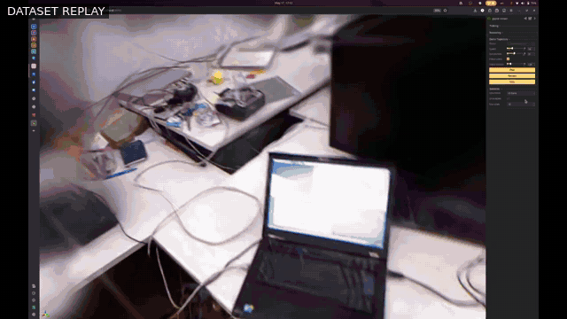
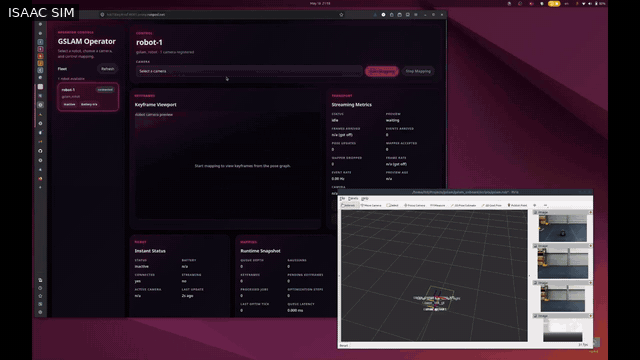
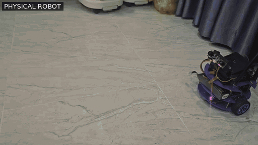
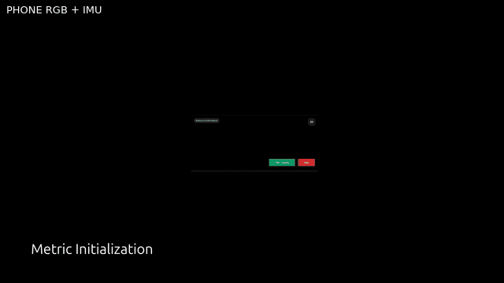
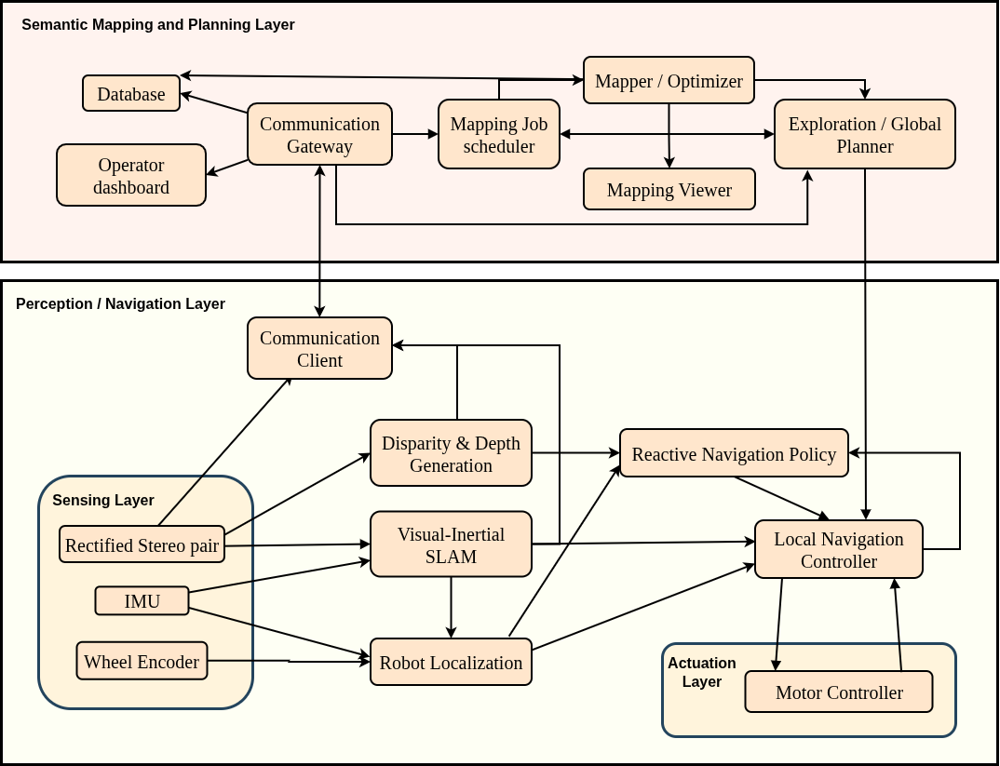
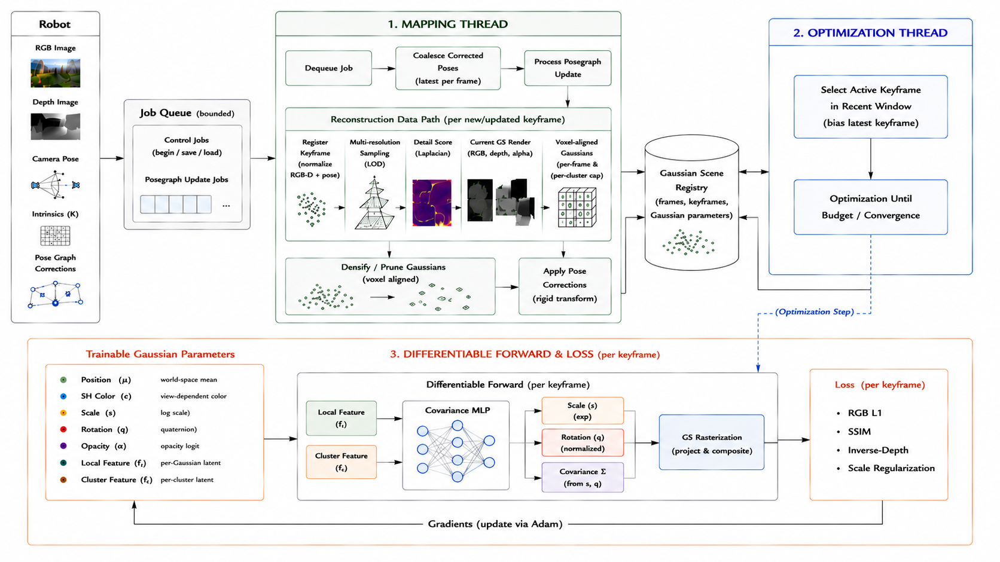
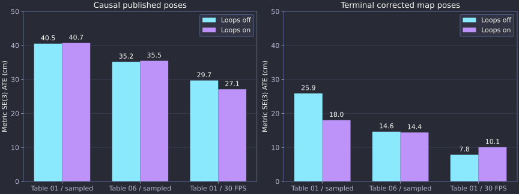

# GSLAM: Online Semantic Gaussian Mapping & Learned Navigation

GSLAM explores how a mobile robot can build a dense, semantically meaningful Gaussian map while continuing to perceive and navigate in real time. It combines a robot perception and control stack, a learned local navigation policy, and an asynchronous mapping server that reconstructs and labels the environment.

<table>
  <tr>
    <td width="50%" align="center">
      
      
RGB-D dataset replay Recorded observations → Gaussian reconstruction

    </td>
    <td width="50%" align="center">
      
      
Isaac Sim Robot runtime, pose streams, and online mapping

    </td>
  </tr>
  <tr>
    <td width="50%" align="center">
      
      
Physical robot Teleoperated integration with real sensing

    </td>
    <td width="50%" align="center">
      
      
Live phone run Monocular RGB + IMU mapping

    </td>
  </tr>
</table>

## 1. Motivation

A useful robot map should describe both where obstacles are and what the scene contains. Gaussian Splatting provides a dense, differentiable representation for geometry and appearance; semantic labels make the scene more interpretable. The challenge is making this representation work with a moving robot, limited onboard compute, imperfect sensors, and an optimization process that is slower than the camera or control loop.

The project separates the system into two cooperating layers:

- **Perception and navigation:** the robot runtime processes stereo images, IMU and wheel odometry, estimates its state, and executes local motion commands using a trained policy.
- **Semantic mapping and planning:** a companion server receives selected RGB-D keyframes and pose updates, incrementally reconstructs the Gaussian scene, annotates it, and generates exploration goals.

## 2. Architecture and implementation

*System architecture from the thesis: local perception and actuation cooperate with remote mapping, exploration, and visualization.*

| Component | Inputs | Responsibility and outputs |
| :--- | :--- | :--- |
| Perception and localization | Stereo RGB, IMU, wheel encoders, calibration | Rectified images, depth, fused odometry, SLAM keyframes and revised poses |
| Learned local navigation | Depth-derived scans, robot motion, relative goal and temporal context | Linear/angular velocity commands |
| Robot safety and drive control | Policy commands, obstacle observations, encoder feedback | Smoothed/collision-filtered commands and wheel actuation |
| Gaussian mapping server | Selected RGB-D keyframes, camera intrinsics and pose-graph revisions | Incremental dense map, optimized scene, historical-pose corrections and checkpoints |
| Semantic annotation | Keyframe/rendered RGB, camera geometry and Gaussian scene | Open-vocabulary labels fused into the 3D map |
| Exploration and operator interface | Map evidence, robot/session status | Frontier goals, mission control, live map inspection and diagnostics |

### 2.1 Learned Navigation Agent 

The learned component is a local goal-conditioned navigation policy. Its job is to choose motion commands that reach local goals while avoiding static and moving obstacles. The training pipeline requires robot assets and dynamics, sensor observations, procedurally generated scenes, a reward/termination definition, and expert rollout data for imitation learning:

1. **Train a Carter MLP expert with PPO.** Use a stable reference embodiment to develop goal-reaching rewards, obstacle avoidance and curriculum progression.
2. **Collect expert trajectories.** Store observations/actions and episode information so target-robot policies can learn a navigation prior through behavior cloning.
3. **Train target policy variants.** Compare a feedforward MLP with stacked scans against GRU/LSTM policies using a current scan and recurrent memory. Recurrent BC trains on ordered sequences.
4. **Fine-tune with PPO on the target embodiment.** Adapt robot geometry, control response and observations, and optimize interaction returns beyond teacher imitation.
5. **Introduce robustness perturbations.** Vary physical parameters, command response/latency and sensor noise/dropout; export candidate policies for runtime integration and hardware testing.

A single range scan provides limited evidence about obstacle velocity. Explicit scan history and recurrent memory are two ways to supply temporal information. Rewards balance goal progress and completion with collision/proximity, stall/orbit behavior and command smoothness; curriculum stages increase static clutter and dynamic difficulty.

### 2.2 Mapping Pipeline

The mapper receives RGB, depth, intrinsics and camera poses; it does not infer all geometry from raw RGB on the robot in this original pipeline. Each accepted keyframe initializes Gaussian primitives by depth unprojection. The scene stores appearance, opacity, scale, rotation and position, with ARTDECO-inspired hierarchical features and covariance prediction.

- **Mapping worker:** register frames, initialize/densify/prune Gaussians, apply pose corrections, refresh snapshots and handle checkpoints.
- **Optimizer worker:** render accepted keyframe windows and update trainable scene parameters using RGB L1, SSIM, inverse-depth and scale-regularization losses.
- **Backpressure:** limit unfinished optimizer work; request the robot to pause and suppress new exploration goals while the optimizer drains. A full scheduler queue can drop incoming pose-update jobs, so bounded memory is not a guarantee that every frame is mapped.
- **Historical corrections:** retain source-frame associations and transform affected Gaussians when SLAM revises camera poses.

## 3. Navigation policy experiments

### 3.1 Environment and training setup

The navigation environment is implemented in Isaac Lab over Isaac Sim, with a reference Carter robot and a target differential-drive embodiment. It contains procedurally placed static geometry and waypoint-driven dynamic obstacles, with goal queues and clearance checks for scene generation.

| Training stage | Purpose | Increasing difficulty |
| :--- | :--- | :--- |
| Goal-reaching prologue | Establish progress and heading behavior | Short goals with no obstacle pressure |
| Static-obstacle curriculum | Learn clearance and recovery | More clutter and varied geometry |
| Mixed static/dynamic curriculum | Learn reactions to moving actors | Crossing, stop-go, speed and motion variation |
| Robustness fine-tuning | Test sensitivity to sensing and actuation mismatch | Dynamics, command latency and scan noise/dropout |

MLP expert rollouts initialize the target policies through BC, followed by PPO. The comparison tests scan history versus recurrent memory, rather than introducing policy architectures only at the point of evaluation. The inspected GRU configuration uses one 128-unit recurrent layer, actor/critic hidden layers `[128, 128]`, 256 rollout steps per environment, learning rate `5e-5`, three learning epochs and four minibatches. The BC implementation supports ordered sequences with default length 32.

### 3.2 Policy comparison

Comparison. Using the training pipeline described above, compare stacked-observation MLP, GRU, and LSTM target-robot policies after BC initialization and PPO fine-tuning. The question is whether recurrent memory can replace explicit scan history in dynamic scenes.

| Target policy | Final success | Goals reached / episode | Collision metric | Stuck metric |
| :--- | ---: | ---: | ---: | ---: |
| GRU | 0.6109 | 7.8932 | 0.2806 | 0.0000 |
| LSTM | 0.5928 | 7.6934 | 0.2978 | 0.0014 |
| Stacked MLP | 0.5818 | 7.8370 | 0.2788 | 0.0015 |

## 4. Mapping experiments

Mapping is evaluated separately from policy training: deterministic RGB-D replay isolates reconstruction/semantic overhead, closed-loop Isaac Sim exercises system integration, and the monocular experiment evaluates metric camera trajectories.

### 4.1 RGB-D dataset replay: the cost of semantics

Setup. TUM RGB-D indoor-room sequences are replayed sequentially through the live mapping engine with exploration disabled. Across the replay trials, the mean input contains 1,362 RGB frames, 1,360 depth frames, and 105 admitted mapping keyframes. Mapping, queueing and sliding-window optimization remain online; this is not an offline batch reconstruction benchmark.

Two configurations compare the same pipeline with semantic inference disabled and enabled. Rendering metrics are computed on cached optimization-window frames, averaged over frames, windows and trials. They measure observed-view reconstruction rather than held-out novel-view synthesis.

| Metric | Semantics disabled | Semantics enabled |
| :--- | ---: | ---: |
| Mean mapping-job latency (ms) | 82.0 | 135.0 |
| P95 mapping-job latency (ms) | 242.1 | 342.6 |
| Peak GPU memory (GB, reported units) | 1.61 | 3.84 |
| PSNR (dB) ↑ | 23.342 | 23.573 |
| SSIM ↑ | 0.7988 | 0.7993 |
| Depth RMSE (m) ↓ | 0.2334 | 0.2434 |
| LPIPS ↓ | 0.3338 | 0.3332 |

Semantic fusion produces labeled Gaussian scenes at approximately 1.65× mean mapping latency and 2.38× peak memory. The RGB/perceptual differences are small, and depth RMSE is worse in the semantic aggregate. Its value is the added semantic annotation, rather than a demonstrated reconstruction improvement. Semantic accuracy itself was not quantified with mIoU in these experiments. The two modes complete different average numbers of optimizer steps (26,509 versus 27,220), so this is an online-system comparison rather than an identical-update-budget ablation.

### 4.2 Closed-loop Isaac Sim mapping

Setup. Carter operates in Isaac Sim with the onboard ROS 2 stack, a rectified 960×576 RGB-D camera, and a remote RunPod mapping server. The backend performs Gaussian densification, sliding-window optimization, frontier planning and checkpointing while the robot explores. Semantics is disabled to isolate the core mapping/exploration loop.

| Sample | Keyframes | Gaussians | PSNR (dB) ↑ | SSIM ↑ | Depth RMSE (m) ↓ | LPIPS ↓ |
| :--- | ---: | ---: | ---: | ---: | ---: | ---: |
| 1 | 32 | 181,809 | 21.774 | 0.8084 | 7.2076 | 0.3473 |
| 2 | 63 | 240,044 | 22.473 | 0.7571 | 0.6378 | 0.4276 |
| 3 | 80 | 341,813 | 23.123 | 0.7904 | 11.7680 | 0.4226 |
| Reported mean | — | — | 22.457 | 0.7853 | 6.5378 | 0.3992 |

Mean mapping-job latency is 64.3 ms, the mean of reported p95 job latencies is 103.8 ms, and evaluation takes 122 ms per four-frame window on average. Mean map-update rate is 0.17 Hz; maximum reported peak GPU memory is 1.74 GB. The recorded summary reports no dropped mapping jobs.

### 4.3 Monocular RGB + IMU: metric scale and loop correction

Setup. Calibrated RPNG AR Table sequences are evaluated with 448×252 mixed TensorRT inference, KV64, eight retained anchors, and one neural camera-refinement iteration. Ground truth is used for scoring only. Loops-off and loops-on comparisons keep synchronous sampled and original-rate asynchronous protocols separate.

- **Causal metric ATE** evaluates poses as first published after metric readiness.
- **Terminal metric ATE** evaluates the final corrected camera map and accepted scale.

| Sequence / protocol | Causal metric ATE, loops off → on (cm) | Terminal metric ATE, loops off → on (cm) |
| :--- | ---: | ---: |
| Table 01, every 15th frame, synchronous | 40.5 → 40.7 | 25.9 → 18.0 |
| Table 06, every 15th frame, synchronous | 35.2 → 35.5 | 14.6 → 14.4 |
| Table 01, original 30 FPS, asynchronous | 29.7 → 27.1 | 7.8 → 10.1 |

## 5. Discussion & Future Work

- **Responsiveness requires explicit scheduling.** Decoupling local control, mapping and optimization makes their rates and backlog manageable; it does not remove the cost of semantic inference.
- **Semantics and reconstruction answer different questions.** Labels add scene understanding even when PSNR changes little. Future evaluation should measure label accuracy and consistency alongside compute cost.
- **A plausible map is not necessarily metrically accurate.** Pose/depth units, scale observability, IMU timing and calibration matter; low scale uncertainty alone does not prove correct convergence.
- **Temporal policies help only within the evaluated conditions.** The recorded recurrent-policy advantage needs repeated seeds and fixed held-out maps to establish robustness beyond these runs.
- **Hardware sensing can dominate transfer.** Synchronized cameras, calibrated depth and measured latency are prerequisites for a meaningful simulation-to-hardware comparison.
